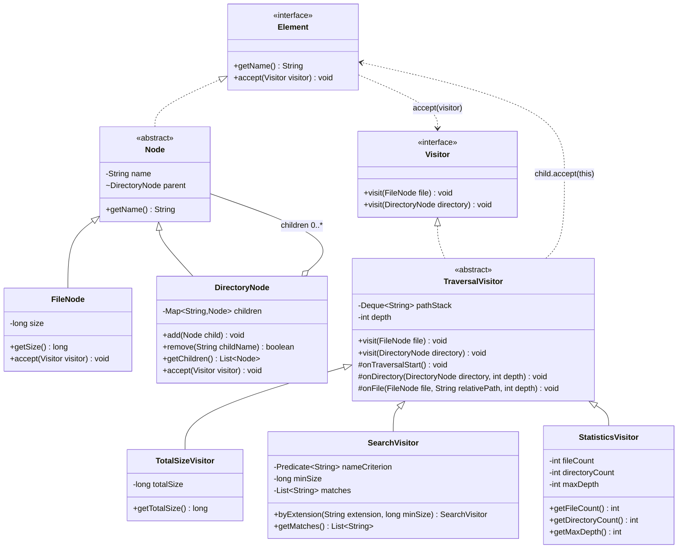

# Visitor Pattern — Advanced File System

Assignment 06, Software Design Patterns (ShP-2216), Astana IT University.
Author: Sissenbay Rassul, group se2538.

An in-memory hierarchical file system with three independent operations
implemented via the Visitor pattern (Java 17, Maven, JUnit 5).

## Requirements
- JDK 17
- Maven 3.8+

## Run tests
```
mvn test
```

## Run the demo
```
mvn compile
java -cp target/classes fs.Main
```
Expected output:
```
Total size: 670
Search (.txt, size >= 50): [docs/notes.txt, readme.txt]
Files: 4, directories: 4, max depth: 3
```

## Structure
| Class | Role |
|---|---|
| `Element` | Element interface: `getName()`, `accept(Visitor)` |
| `Visitor` | Declares `visit(FileNode)` and `visit(DirectoryNode)` |
| `Node` | Abstract base: validated name, single parent |
| `FileNode` | Leaf with non-negative size |
| `DirectoryNode` | Composite; guarded `add`/`remove`, read-only `getChildren()` |
| `TraversalVisitor` | Owns the traversal, depth and path tracking |
| `TotalSizeVisitor` | Sum of file sizes in a subtree |
| `SearchVisitor` | Name predicate + inclusive min size, sorted root-relative paths |
| `StatisticsVisitor` | File count, directory count, max depth |
## UML Class Diagram


## Design decisions
- **Double dispatch:** `accept` calls `visitor.visit(this)`. `this` has the static type
  `FileNode` or `DirectoryNode`, so the compiler picks the right overload.
  No `instanceof`, casts or reflection in the main code.
- **Traversal owner:** the `TraversalVisitor` base class. It calls `child.accept(this)`
  once per child, so every reachable node is visited exactly once.
  Children are stored in a `TreeMap`, so the order is deterministic.
- **Paths:** built from a stack of directory names, root name excluded, `/` as separator,
  sorted lexicographically in `SearchVisitor.getMatches()`. A root file's path is its name.
- **Depth:** root = 0, each level +1 (a file directly in the root has depth 1).
- **State:** visitors are reusable. `onTraversalStart()` resets results whenever a new
  traversal begins at a root, so results never depend on run order.
- **Integrity:** negative size, duplicate sibling name, second parent, and cycles
  (self or ancestor) throw `IllegalArgumentException`.
- **Extension boundary:** `StatisticsVisitor` was added without changing `FileNode`,
  `DirectoryNode` or their `accept` methods. Adding a new element type would change the
  `Visitor` interface and require updating all visitors.

## Tests (JUnit 5)
`DoubleDispatchTest`, `TotalSizeVisitorTest`, `SearchVisitorTest`,
`StatisticsVisitorTest`, `TreeIntegrityTest` (shared fixture: `Fixtures`).